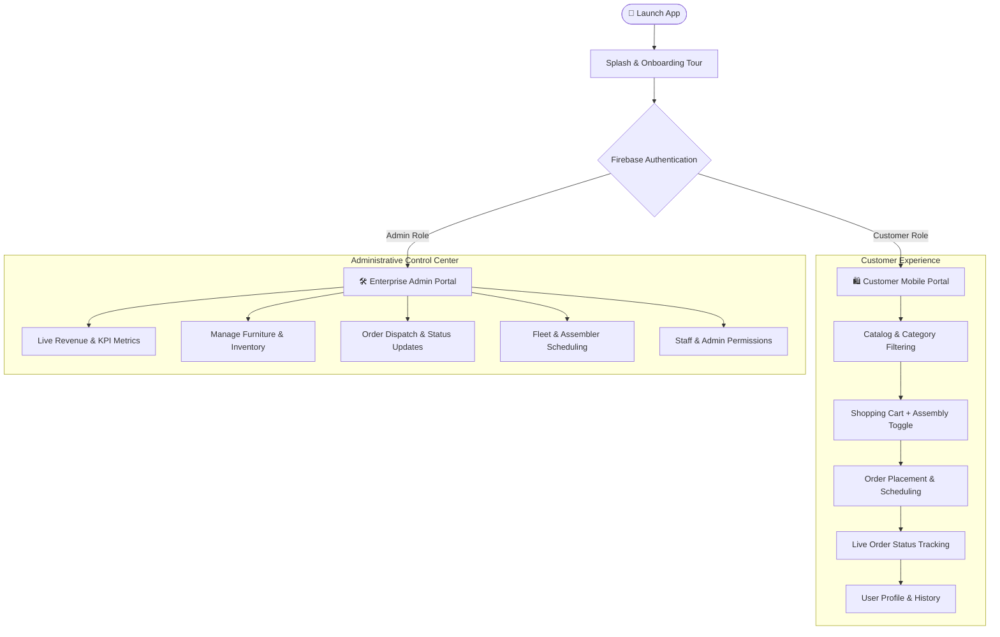
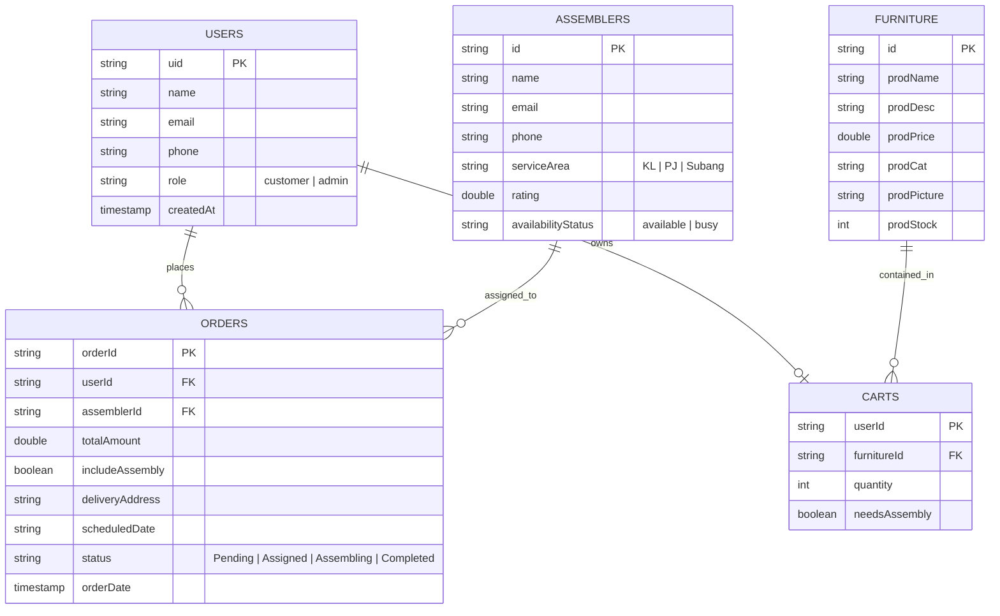

# 🛋️ BeliBina — Smart Furniture E-Commerce & On-Demand Assembly Android App

[](https://www.android.com/)
[](https://www.oracle.com/java/)
[](https://firebase.google.com/)
[](https://firebase.google.com/docs/firestore)
[](https://m3.material.io/)
[]()
[](LICENSE)

> **BeliBina** (from Malay: *"Beli"* — Buy & *"Bina"* — Build) is a full-featured Android mobile application that bridges retail furniture e-commerce with **on-demand professional furniture assembly services**. Built on Java and **Google Firebase (Authentication & Cloud Firestore)** with Material Design 3, it offers dual customer and enterprise administrator portals to eliminate flat-pack furniture assembly frustrations through seamless booking, real-time dispatching, and order tracking.

---

## 📌 Problem Background & Solution Concept

Modern flat-pack furniture (e.g., KALLAX units, BILLY bookcases, desks, bed frames) offers affordable home decor, but consumers consistently struggle with complex instruction manuals, missing tools, and lengthy installation times—often referred to as *"flat-pack syndrome"*. Conversely, independent furniture handymen and assemblers lack a dedicated digital marketplace to connect with nearby clients.

**BeliBina** provides a comprehensive end-to-end mobile solution:
* **"Beli" (Buy):** Browse an extensive digital furniture catalog, filter by home category (Storage, Tables, Seating, Bedroom), inspect dimensions and stock availability, and manage shopping cart items.
* **"Bina" (Build):** Toggle on-demand professional assembly during checkout. The system calculates optional assembly surcharges, lets customers schedule preferred installation time slots, and assigns qualified local assemblers across Kuala Lumpur, Petaling Jaya, and Subang Jaya.
* **Dual-Role Ecosystem:** Separate customer and administrative environments ensure that while customers enjoy smooth shopping and order tracking, warehouse and store administrators maintain full control over inventory, staff assignments, and logistics.

---

## 📱 User Portals & Core Features



### 1. 🛍️ Customer Mobile Experience
* **Interactive Onboarding Carousel:** Dynamic introductory tour highlighting seamless purchasing and professional assembly perks (`OnboardingActivity`).
* **Firebase Authentication:** Secure email/password registration and login with session persistence (`LoginActivity`, `RegisterActivity`).
* **Categorized Furniture Catalog:** Real-time Firestore synchronization supporting instant search and classification across **Storage**, **Tables**, **Seating**, and **Bedroom** suites (`CatalogFragment`).
* **Smart Shopping Cart:** Flexible item counter with integrated **"Include Assembly Service"** toggle that dynamically updates price breakdowns (`CartActivity`, `CartAdapter`).
* **Dispatch & Assembly Booking:** Date-picker scheduling, delivery address confirmation, and nearby vetted technician selection (`OrderPlacementFragment`).
* **Multi-Stage Order Tracking:** Tabbed order status management across **Pending**, **Assigned**, **In Assembly**, and **Completed** (`MyOrdersFragment`, `OrdersListFragment`).

### 2. 🛠️ Enterprise Administrator Portal (`AdminActivity`)
* **Executive KPI Dashboard:** Real-time aggregated statistics displaying total accumulated revenue, active order queues, registered fleet technicians, and low-inventory alerts (`AdminDashboardFragment`).
* **Catalog Inventory CRUD:** Create, edit, and decommission furniture listings with image URLs, stock quantities, and prices (`ManageProductFragment`, `AddEditProductBottomSheet`).
* **Order Dispatch & Action Sheet:** Assign orders to available certified assemblers, adjust logistics status, and process deliveries (`AdminOrdersFragment`, `AdminOrderActionBottomSheet`).
* **Assembler Fleet Management:** Monitor technician ratings (e.g., 4.8★), operating zones (Kuala Lumpur, PJ, Subang), and live availability (`AdminAssemblersFragment`, `AddAssemblerBottomSheet`).
* **Role Delegation:** Create and manage administrative team accounts (`ManageAdminFragment`, `AddAdminBottomSheet`).

---

## 🗄️ Database Architecture (Cloud Firestore)

BeliBina utilizes a NoSQL document-oriented schema hosted on **Google Cloud Firestore**:



---

## 📂 Project Directory Structure

```text
BeliBina/
├── README.md                      # Comprehensive system documentation
├── build.gradle.kts               # Root Gradle configuration
├── settings.gradle.kts            # Project modules & repository repositories
├── gradle.properties              # JVM options & AndroidX flags
├── local.properties.example       # Android SDK path template
├── .gitignore                     # Ignores build/, .gradle/, and local.properties
├── seed/                          # Firestore seed assets & node importer
│   ├── furniture.json             # Initial catalog seed items
│   ├── assemblers.json            # Seed technician profiles
│   ├── import.js                  # Automated Firebase Admin SDK batch importer
│   └── serviceAccountKey.example.json # Service account credentials template
└── app/                           # Android application module
    ├── build.gradle.kts           # App-level dependencies & SDK configs
    ├── google-services.json       # Firebase client connection configuration
    └── src/main/
        ├── AndroidManifest.xml    # App manifest & permissions
        ├── assets/                # Fallback offline JSON catalogs
        ├── java/com/belobina/app/
        │   ├── activities/        # Splash, Login, Register, Main, Admin, Cart
        │   ├── adapters/          # RecyclerView & ViewPager2 adapters
        │   ├── fragments/
        │   │   ├── admin/         # Dashboard, Product/Order/Assembler management
        │   │   └── customer/      # Catalog, Cart, OrderPlacement, Profile
        │   ├── models/            # POJO data models (Furniture, Order, User, Assembler)
        │   ├── repositories/      # MVVM Firestore & Auth data access layer
        │   └── utils/             # FirebaseHelper, Constants, Callback interfaces
        └── res/                   # Layouts, themes, drawables, fonts & nav graphs
```

---

## 🛠️ Step-by-Step Installation & Setup

### 1. Prerequisites
* **Android Studio:** Ladybug (2024.2+) or newer.
* **JDK:** Version 11 or 17 configured in Android Studio.
* **Android SDK:** API Level 35 (Android 15) installed with Build Tools.
* **Google Firebase Account:** With **Firebase Authentication** (Email/Password) and **Cloud Firestore** activated.

### 2. Clone the Repository
```bash
git clone https://github.com/akhmal02/BeliBina.git
```

### 3. Open in Android Studio
1. Launch Android Studio and choose **Open an Existing Project**.
2. Navigate to and select the cloned `BeliBina` directory.
3. Allow Gradle to perform its initial sync.

### 4. Configure Local SDK (`local.properties`)
If prompted, copy `local.properties.example` to `local.properties` and verify your SDK location:
```properties
sdk.dir=C\:\\Users\\YourUsername\\AppData\\Local\\Android\\Sdk
```

### 5. (Optional) Seed Initial Catalog into Cloud Firestore
To quickly populate your Firestore database with the pre-configured catalog and assemblers:
1. Navigate to the `seed/` directory:
   ```bash
   cd seed
   npm install firebase-admin
   ```
2. Place your downloaded Firebase `serviceAccountKey.json` into the `seed/` directory.
3. Run the import script:
   ```bash
   node import.js
   ```

### 6. Build & Run
1. Connect a physical Android device via USB debugging or start an Android Virtual Device (AVD).
2. Press **Run ▶ (Shift + F10)** in Android Studio.

---

## 👨‍💻 Author & Academic Attribution
* **Developer:** Muhammad Akhmal bin Mohamad Hussin ([@akhmal02](https://github.com/akhmal02))
* **Institution:** Universiti Teknologi MARA (UiTM)
* **Faculty:** College of Computing, Informatics and Mathematics
* **Specialization:** Mobile Computing & Enterprise Application Development
